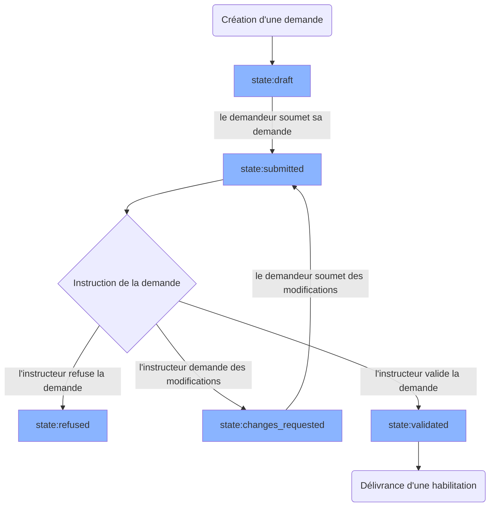
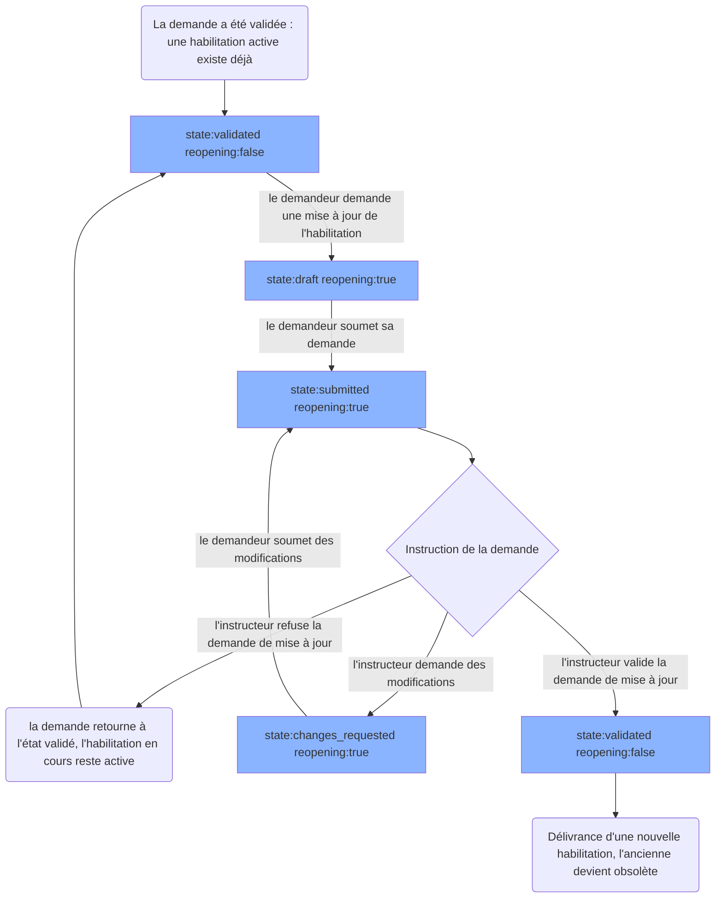
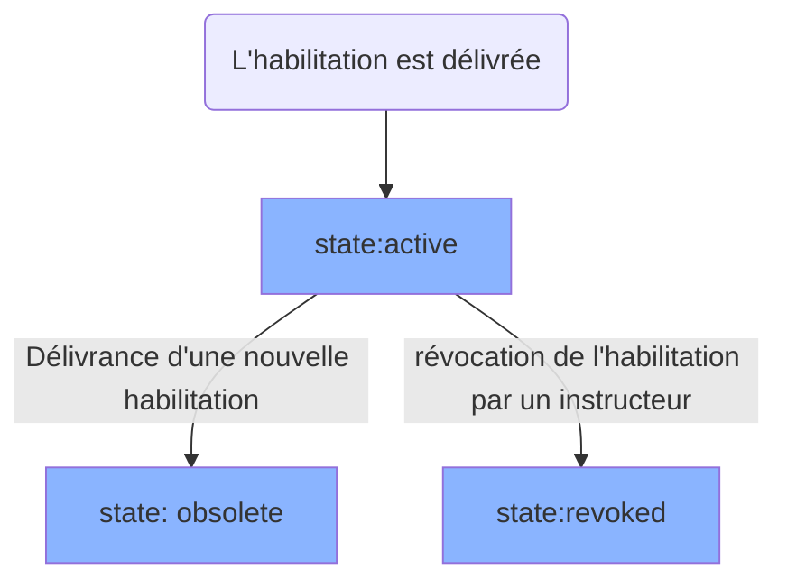

# Cycle de vie d'une Demande

## Cas d'une demande initiale

Voici le cycle de vie basique d'une demande.

Une demande peut être archivée par l'instructeur ou le demandeur (si elle n'a aucune habilitation active), dans ce cas le status devient <code>archived</code>, et elle ne sera plus visible dans DataPass.

## Cas d'une demande de mise à jour (réouverture)

Le demandeur peut demander la mise à jour d'une habilitation active : sa demande repasse alors en instruction pour apporter des changements à l'habilitation qui lui a été délivrée. Dans le code, ce cycle s'appelle `reopening` (un paramètre booléen porte cet état) ; dans les textes affichés, on parle de « demande de mise à jour ».

Voici le cycle de vie d'une demande de mise à jour.

Après la délivrance de la nouvelle habilitation, la demande aura donc donné lieu à 2 habilitations.

# Status d'une Habilitation

Une habilitation commence son existence `state:active`. Si une nouvelle habilitation est délivrée à la suite d'une demande de mise à jour, l'ancienne habilitation devient `state:obsolete`.

Une habilitation peut aussi être révoquée par un instructeur, devenant donc `state:revoked`.

