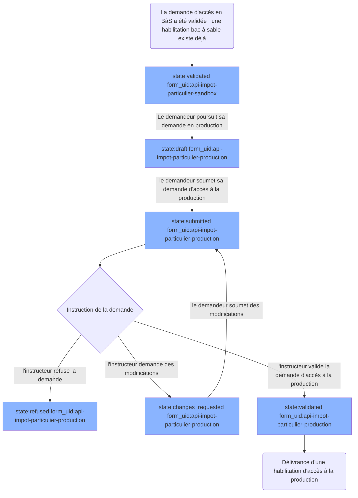

# Cycle de vie d'une Demande avec stages

Une demande avec stages c'est typiquement une demande qui doit passer par 2 étapes d'instructions : une première étape pour habiliter l'accès à un `Bac à Sable`, une seconde étape pour habiliter l'accès à la `Production`. Aujourd'hui, cela ne concerne que les habilitations de la DGFiP.

## Cas d'une demande initiale d'accès en bac à sable

Tout se passe comme pour une demande d'accès "classique".

> [Voir le cycle de vie classique d'une demande sans stages](./lifecycle_documentation.md)

## Cas d'une demande de mise à jour d'une habilitation bac à sable

Tout se passe comme pour une demande d'accès "classique".

> [Voir le cycle de vie classique d'une demande sans stages](./lifecycle_documentation.md)

## Cas d'une demande d'accès en production

Une fois la demande d'accès en bac à sable (BàS) validée, et l'habilitation bac à sable délivrée, le demandeur peut poursuivre sa demande pour obtenir un accès en production.

A ce moment là, la demande est transformée pour changer de `type` et de `form_uid`. Elle conserve néanmoins ses données remplies lors de la demande de Bac à Sable, ainsi que l'habilitation bac à sable précédemment délivrée.

Le demandeur va remplir les champs supplémentaires décrits par le formulaire d'accès à la production, et re-soumettre sa demande qui repassera par le cycle de vie "classique".

## Cas d'une demande de mise à jour (réouverture)

**Si le demandeur demande une mise à jour de son habilitation de production** : la demande suit le cycle de mise à jour « classique ».

**Si le demandeur demande une mise à jour de son habilitation bac à sable** : la demande change de `type` et de `form_uid` pour redevenir une demande de bac à sable, qui suit le cycle de mise à jour « classique ». Une fois la demande de mise à jour validée par un instructeur, le demandeur peut poursuivre sa demande en production, qui suit le cycle de demande de production « classique ».

