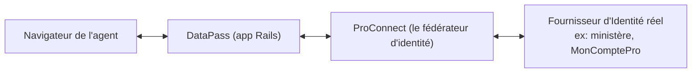
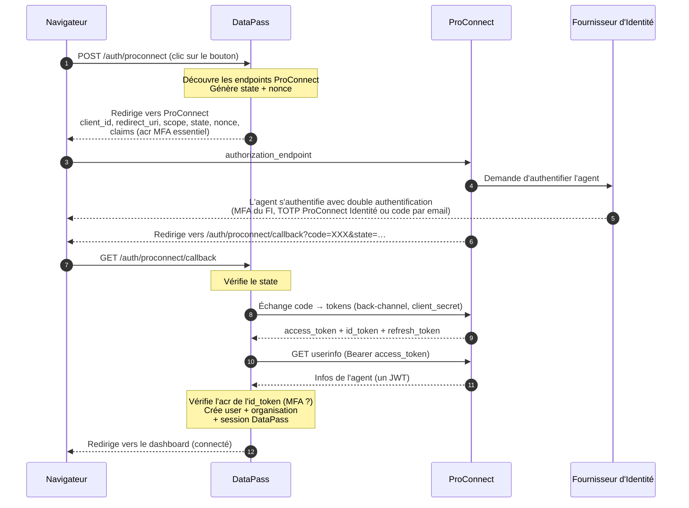
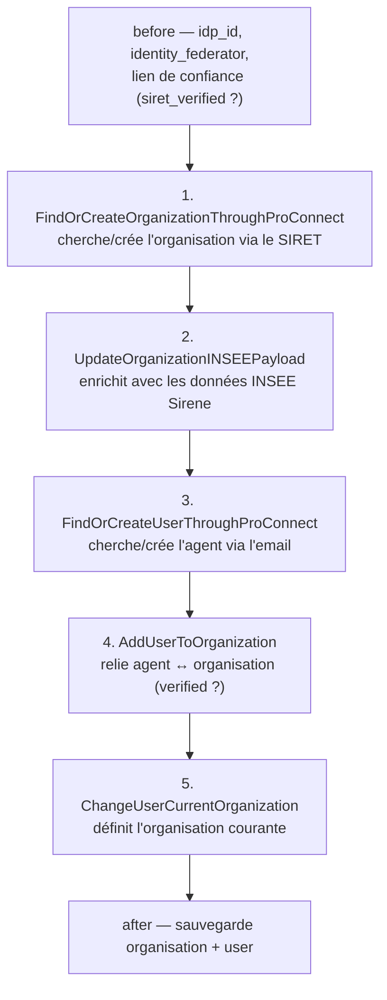
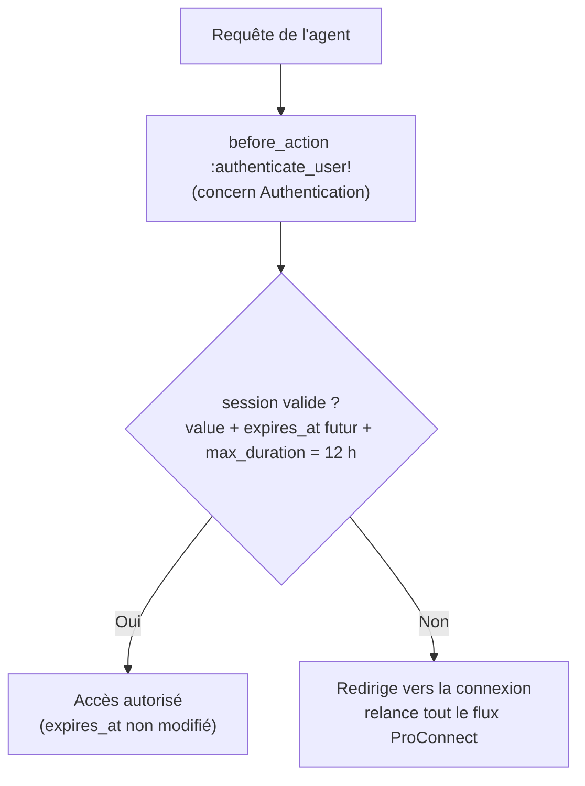
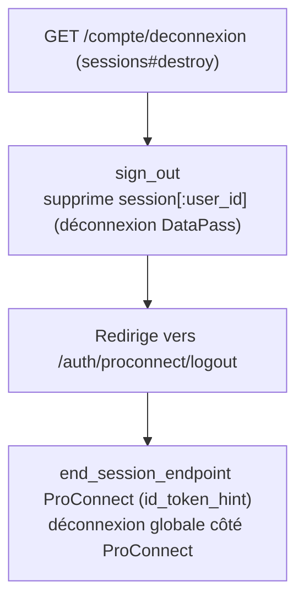

# Authentification des agents via ProConnect

Ce document décrit le processus complet d'authentification d'un agent sur DataPass.
Il couvre le flux ProConnect (actuel), la chaîne de traitement côté DataPass, la gestion
de session, la déconnexion, les mécanismes de sécurité, et le provider legacy MonComptePro.

> Ce document se lit à deux niveaux. La section **« Le principe en bref »** ci-dessous donne
> une vue d'ensemble accessible sans connaissance technique. Les sections suivantes entrent
> dans le détail du code et s'adressent aux développeurs. Un **glossaire** est disponible en
> fin de page.

## Le principe en bref

DataPass ne gère pas lui-même l'authentification des agents : il la délègue entièrement à
ProConnect. ProConnect joue le rôle de fédérateur d'identité — une porte d'entrée unique qui
s'appuie, selon l'agent, sur le fournisseur d'identité adéquat (l'annuaire de son ministère,
ProConnect-Identité pour les agents sans annuaire dédié, etc.), choisi d'après le domaine de
son email.

Le déroulé est le suivant :

- L'agent demande à se connecter à DataPass, qui le redirige vers ProConnect.
- ProConnect vérifie son identité auprès du bon fournisseur. Lorsque ce fournisseur impose une
  double authentification, DataPass s'assure qu'elle a bien eu lieu et la réclame activement si
  ProConnect ne l'a pas déjà appliquée. DataPass ne voit jamais le mot de passe de l'agent.
- Une fois l'agent authentifié, ProConnect renvoie à DataPass une preuve d'identité, que
  DataPass échange en arrière-plan contre les informations de l'agent : nom, email, et surtout
  le SIRET de l'organisation où il travaille.
- DataPass en déduit trois choses : qui est l'agent, dans quelle organisation il travaille, et
  si ce lien peut être considéré comme vérifié. Il ouvre alors une session applicative courte,
  alignée sur ProConnect.
- La session suit un modèle à **plafond absolu de 12 h** : `expires_at` est fixé à la connexion
  (`signed_in_at + 12 h`) et n'est jamais prolongé. Au-delà de 12 h — ou après une déconnexion
  — le parcours complet recommence. Cet alignement sur les 12 h de ProConnect réduit la fenêtre
  d'exposition (poste partagé, cookie volé).

Les sections suivantes détaillent l'implémentation de ce parcours.

## Vue d'ensemble



Idée centrale : **DataPass ne gère aucun mot de passe.** Il délègue la preuve d'identité à
ProConnect, qui est un *fédérateur* : un seul bouton « ProConnect » côté DataPass, mais
plusieurs fournisseurs d'identité (FI) derrière (l'IdP d'un ministère, ProConnect-Identité
ex-MonComptePro pour les agents sans IdP dédié, etc.). ProConnect choisit le bon FI selon le
domaine de l'email de l'agent.

Le protocole est **OpenID Connect (OIDC)**, dans sa variante « Authorization Code Flow ».

## Première connexion



Étapes détaillées :

1. **Départ.** L'agent clique sur le bouton (`_pro_connect.html.erb` →
   `POST /auth/proconnect`). La gem `omniauth-proconnect` intercepte cette route. Elle
   interroge ProConnect pour découvrir ses endpoints (`discover_endpoint!` sur
   `.well-known/openid-configuration`), génère un `state` et un `nonce` stockés en session.
2. **Redirection.** La gem renvoie le navigateur vers l'`authorization_endpoint` de
   ProConnect avec `client_id`, `redirect_uri`, `scope`, `state`, `nonce`, et un paramètre
   `claims` qui exige une double authentification (voir « La double authentification
   obligatoire » plus bas).
3. **Authentification chez ProConnect.** L'agent choisit son organisation, s'authentifie, puis
   valide sa double authentification. DataPass ne voit rien de cette étape.
4. **Retour avec un code.** ProConnect renvoie le navigateur vers
   `/auth/proconnect/callback` avec un `code` à usage unique et le `state`. DataPass vérifie
   d'abord que le `state` correspond à celui qu'il avait émis (`verify_state!`).
5. **Échange code → tokens (back-channel).** Le `code` seul est inutile. DataPass rappelle
   ProConnect **de serveur à serveur** (le navigateur n'est pas dans la boucle), avec son
   `client_secret`, pour échanger le code contre des tokens (`access_token`, `id_token`,
   `refresh_token`), stockés en session sous `omniauth.pc.*`.
6. **Récupération des infos agent.** DataPass appelle le `userinfo_endpoint` avec
   l'`access_token`. Particularité ProConnect : la réponse est un **JWT** (jeton signé), pas
   du JSON brut. Il est décodé dans `@userinfo`. Claims utiles : `sub` (identifiant unique),
   `email`, `given_name`, `usual_name`, `siret`, `idp_id` (quel FI a servi), `phone_number`.
   L'`acr` de l'`id_token` (niveau de garantie atteint) est exposé à côté, dans
   `extra.acr` du hash OmniAuth.
7. **Construction côté DataPass.** Voir la section suivante.

## Traitement côté DataPass (étape 7)

Le `SessionsController#create` reçoit le callback OmniAuth, aiguille vers
`create_from_proconnect`, vérifie la double authentification (voir plus bas), puis appelle l'organizer
`AuthenticateUserThroughProConnect` :



Trois objets distincts en sortent : **qui** est l'agent (User, via email), **où** il travaille
(Organization, via SIRET enrichi INSEE), et le **lien de confiance** entre les deux (`verified`
ou non, selon le FI).

À chaque connexion, `FindOrCreateUserThroughProConnect` resynchronise le nom (`usual_name`), le
prénom (`given_name`) et le téléphone (`phone_number`) de l’agent, **seulement quand le FI les
transmet** : une valeur vide ou absente laisse en place celle déjà connue du compte (certains FI
fédérés, comme celui de la CNAM, ne transmettent pas le téléphone). Le poste (`job_title`) n’est
jamais fourni par ProConnect et n’est donc pas touché. La chaîne MonComptePro applique la même
règle, poste compris.

Le controller appelle ensuite `sign_in`, qui crée la **session applicative DataPass**. La logique
de cycle de vie est isolée dans le concern `Authentication::SessionLifecycle` (durée, validation,
rotation). Au login, `rotate_session` régénère l'identifiant de session (protection
contre la *fixation de session*) tout en préservant les tokens ProConnect (`omniauth.pc.*`) et le
chemin de retour. La session porte un unique plafond absolu : `expires_at` fixé à la connexion
(`SESSION_MAX_DURATION = 12.hours`) :

```ruby
rotate_session

session[:user_id] = {
  value: user.id,
  expires_at: SESSION_MAX_DURATION.from_now,
  max_duration: SESSION_MAX_DURATION.to_i,
  identity_federator:,
  identity_provider_uid:,
}
```

Enfin, si le FI a `choose_organization_on_sign_in?` à vrai (agent multi-organisations), DataPass
redirige vers la page de choix d'organisation (`user_organizations_path`). Sinon, direction le
dashboard.

## Connexions suivantes : ProConnect n'est plus sollicité



Une fois connecté, DataPass vit sur **sa propre session** (cookie chiffré, plafond absolu de
12 h). À chaque requête authentifiée, `expires_at` est vérifié mais jamais prolongé : un seul
timer fixe depuis la connexion. Un ancien cookie sans marqueur `max_duration` valide (cookie
antérieur à DP-1820) est rejeté → reconnexion douce (re-clic silencieux si la session ProConnect
est encore active). DataPass ne
rappelle pas ProConnect à chaque page ; ProConnect ne sert qu'à prouver l'identité au moment du
login.

> **DP-1820** a simplifié le modèle introduit par DP-1789 : l'ancien mécanisme de fenêtre
> glissante (`slide_session_expiry`) et le plafond secondaire de 24 h (`SESSION_ABSOLUTE_TIMEOUT`,
> `absolute_expires_at`) sont supprimés. Il reste un seul timer absolu : `expires_at`.

Il y a donc **deux sessions distinctes** :

- les **tokens ProConnect** (`omniauth.pc.*`) — utilisés au login et conservés surtout pour la
  déconnexion globale ;
- la **session applicative DataPass** (`session[:user_id]`) — c'est elle qui maintient l'agent
  connecté (plafond absolu 12 h depuis la connexion, sans prolongation par l'activité).

## Mécanismes de sécurité

**Le `state` — éviter qu'une connexion soit détournée.**
Au moment d'envoyer l'agent vers ProConnect, DataPass génère un identifiant aléatoire propre à
cette tentative de connexion, le conserve dans la session et le transmet à ProConnect, qui le
renvoie inchangé. Au retour, DataPass vérifie que les deux correspondent (`verify_state!`). Sans
ce contrôle, un tiers pourrait forger une réponse d'authentification et la faire traiter par le
navigateur de la victime (attaque CSRF) ; le `state` garantit que la réponse traitée répond bien
à une demande émise depuis ce navigateur. En cas de différence, la connexion est rejetée.

**Le `nonce` — empêcher la réutilisation d'un ancien jeton.**
DataPass insère un second identifiant aléatoire dans la demande ; ProConnect le réinscrit à
l'intérieur de l'`id_token` qu'il délivre. DataPass vérifie ainsi que le jeton reçu a bien été
émis pour cette demande précise, et non rejoué à partir d'un échange antérieur intercepté. Là où
le `state` protège l'aller-retour de la requête, le `nonce` protège le contenu du jeton.

**La double authentification obligatoire — pour tous les agents.**
(Janvier 2026 : réservée aux agents MonComptePro via un aller-retour de réauthentification ;
octobre 2026 : étendue à tous, DPP-166.) Dès la requête d'autorisation, DataPass réclame à
ProConnect un `acr` MFA comme claim essentiel de l'`id_token` :
`claims={"id_token":{"acr":{"essential":true,"values":["eidas0-mfa","eidas1-mfa","eidas2","eidas3"]}}}`
(`MFA_ACR_VALUES`, `mfa_claims`). ProConnect fait alors faire le second facteur à l'agent : le
MFA de son fournisseur d'identité s'il en a un, le TOTP pour ProConnect Identité, sinon un code
à usage unique envoyé par email (`eidas1-mfa`).

Au retour, comme l'exige la documentation ProConnect, DataPass vérifie l'`acr` de l'`id_token`
(`extra.acr`, `mfa_performed?`). S'il ne fait pas partie des valeurs MFA — ou s'il est absent —
la connexion est refusée (`reject_sign_in_without_mfa`) : aucune session n'est ouverte, l'agent
revient sur la page d'accueil avec le message recommandé par ProConnect, et l'événement remonte
dans Sentry en `error` (un vrai agent est bloqué, quelqu'un doit regarder). Ce cas se produira
là où ProConnect ne peut pas relayer de code par email : services sur le RIE, et tout le monde
après la fin du relais email, le 28/02/2027.

Référence : https://partenaires.proconnect.gouv.fr/docs/fournisseur-service/double_authentification

> Repère : `acr` (*Authentication Context Class Reference*) = le niveau de garantie atteint ;
> les valeurs suffixées `-mfa`, `eidas2` et `eidas3` attestent d'un second facteur.

**La rotation de session — empêcher la fixation de session.**
Au moment du login (`sign_in`), DataPass régénère l'identifiant de session (`rotate_session` →
`reset_session`) pour qu'un identifiant éventuellement connu d'un attaquant avant authentification
ne donne aucun accès après. Les clés strictement nécessaires sont préservées : les tokens
ProConnect (`omniauth.pc.access_token`, `id_token`, `refresh_token`, indispensables au logout
global) et `return_to_after_sign_in`. Le plafond absolu de 12 h complète ce durcissement en
réduisant la fenêtre d'exploitation d'un cookie volé.

**La durée de session courte — réduire la fenêtre d'exposition.**
L'ordre des contrôles dans `authenticate_user!` est volontaire : validité de session, puis
bannissement (`BannedUserError`), puis `return` — pour ne jamais autoriser l'accès d'un agent
banni. Limites de ce palier *stateless* (cookie store, sans store serveur) : pas de révocation à
distance ni de « déconnecter partout », un cookie volé reste valide jusqu'à son expiration (12 h).
Ces points seront traités par **DP-1790** (store serveur révocable).

## Validation partagée avec Rails Pulse

Le tableau de bord Rails Pulse (`/rails_pulse`) est réservé aux admins. Pour vérifier la
session, il réutilise le même prédicat que l'app : `Authentication::SessionLifecycle.valid_session?`
(voir `config/initializers/rails_pulse.rb`). Une seule logique de validation, pas de doublon.

## Déconnexion



## Provider legacy MonComptePro

Un second provider existe dans `config/initializers/omniauth.rb` : `mon_compte_pro` (l'ancêtre,
AgentConnect/MonComptePro, aujourd'hui ProConnect Identité interrogé en direct, hors fédération
ProConnect). Il ne sert plus à se connecter : il ne reste que pour changer d'organisation avec
le prompt `select_organization`, que la fédération ProConnect ne propose pas encore. Les boutons
« Rejoindre une autre organisation » (`user/organizations/index`, agents ProConnect Identité) et
« Changer d'organisation » (`authorization_requests/closed_organization`) l'utilisent.

Comme ce provider ne passe pas par la double authentification ProConnect, son callback n'ouvre
jamais de session. `SessionsController#create_from_mon_compte_pro` exige :

- un agent déjà connecté, via ProConnect (`identity_federator` de la session à `proconnect`) ;
- le même email côté MonComptePro que celui de l'agent connecté.

Si c'est le cas, `ChangeCurrentOrganizationThroughMonComptePro` change l'organisation courante
(lien vérifié, « from MonComptePro identity ») et la session ProConnect est conservée. Sinon :
message d'erreur, `Sentry.capture_message` en `warning`, redirection vers l'accueil.

`AuthenticateUserThroughMonComptePro` et `FindOrCreateUserThroughMonComptePro` n'ont plus
d'appelant ; leur retrait, avec celui du provider, attend que ProConnect propose le choix
d'organisation.

## En une phrase

ProConnect prouve l'identité une fois (OIDC code flow) ; DataPass en tire trois objets — agent,
organisation, lien de confiance — puis vit sur sa propre session courte (plafond absolu 12 h
depuis la connexion, sans prolongation par l'activité).

## Fichiers de référence

| Rôle | Fichier |
|---|---|
| Config des providers, scopes, MFA | `config/initializers/omniauth.rb` |
| Gem du flux OIDC ProConnect | `omniauth-proconnect` (`lib/omniauth/proconnect.rb`) |
| Routes auth | `config/routes.rb` (`auth/:provider/callback`, `compte/deconnexion`) |
| Bouton de connexion | `app/views/pages/shared/unauthenticated_pages/_pro_connect.html.erb` |
| Aiguillage du callback, MFA, logout | `app/controllers/sessions_controller.rb` |
| Session applicative (sign_in/out) | `app/controllers/concerns/authentication.rb` |
| Cycle de vie de session (durée, validation, rotation) | `app/controllers/concerns/authentication/session_lifecycle.rb` |
| Organizer ProConnect | `app/organizers/authenticate_user_through_pro_connect.rb` |
| Organisation depuis le SIRET | `app/interactors/find_or_create_organization_through_pro_connect.rb` |
| Enrichissement INSEE | `app/interactors/update_organization_insee_payload.rb` |
| User depuis l'email | `app/interactors/find_or_create_user_through_pro_connect.rb` |
| Lien agent ↔ organisation | `app/interactors/add_user_to_organization.rb` |
| Organisation courante | `app/interactors/change_user_current_organization.rb` |
| Caractéristiques d'un FI | `app/models/identity_provider.rb` + `config/identity_providers.yml` |
| Provider legacy (changement d'organisation) | `app/organizers/change_current_organization_through_mon_compte_pro.rb` |

## Glossaire

| Terme | En clair |
|---|---|
| **ProConnect** | Le service de l'État qui authentifie les agents publics pour le compte de nombreuses applications. DataPass lui délègue entièrement la connexion. |
| **Fournisseur d'identité (FI)** | Le service qui détient et vérifie réellement l'identité de l'agent (annuaire d'un ministère, ProConnect-Identité…). ProConnect choisit le bon selon l'email de l'agent. |
| **OIDC (OpenID Connect)** | Le protocole standard d'authentification déléguée utilisé entre DataPass et ProConnect pour échanger une preuve d'identité de façon sécurisée. |
| **Fédérateur d'identité** | Un intermédiaire qui regroupe plusieurs fournisseurs d'identité derrière une seule porte d'entrée. ProConnect en est un. |
| **Token (jeton)** | Une donnée signée délivrée par ProConnect qui atteste que l'agent a été authentifié et permet à DataPass de récupérer ses informations. |
| **Scope** | La liste des informations que DataPass a le droit de demander sur l'agent (nom, email, SIRET…). |
| **SIRET** | Le numéro qui identifie officiellement l'organisation (l'employeur) de l'agent. DataPass s'en sert pour reconnaître l'organisation. |
| **INSEE Sirene** | Le registre officiel des entreprises et administrations. DataPass y récupère les informations détaillées d'une organisation à partir de son SIRET. |
| **Session** | L'état de connexion maintenu par DataPass après authentification (plafond absolu 12 h depuis la connexion, sans prolongation), qui évite de repasser par ProConnect à chaque page. |
| **MFA (double authentification)** | Une vérification supplémentaire (code sur téléphone, application, code reçu par email…) en plus du mot de passe. DataPass l'exige pour tous les agents qui se connectent via ProConnect. |
| **Back-channel** | Un échange direct de serveur à serveur entre DataPass et ProConnect, sans passer par le navigateur de l'agent — donc non exposé côté client. |
| **state / nonce** | Deux identifiants aléatoires générés par DataPass pour s'assurer que la réponse reçue de ProConnect est authentique et n'est pas rejouée. |
